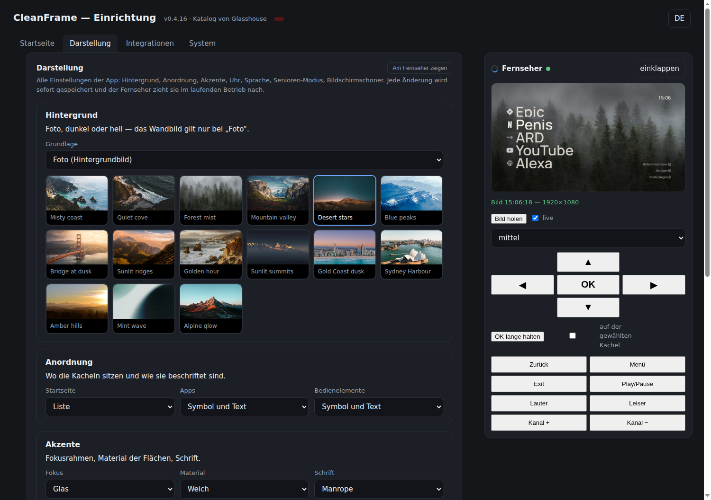

# CleanFrame für webOS

**Inoffizielle Portierung von [CleanFrame](https://github.com/nthnclrk/CleanFrame) auf
LG-Fernseher mit webOS 6 oder neuer.** Nicht mit dem Original verbunden, nicht vom
ursprünglichen Autor betreut.

CleanFrame wurde für Samsung The Frame (Tizen) geschrieben: ein Foto, eine große Uhr und die
eigenen Apps statt eines überladenen Hersteller-Startbildschirms. Diese Portierung übernimmt
den Originalcode — Oberfläche, Fokus-Logik, Einstellungen, Wandbilder, Materialien — und
ersetzt nur die Geräteanbindung: `app/device.js` spricht den lokal auf dem Fernseher laufenden
[Glasshouse](https://github.com/rorygallagher2024/glasshouse)-Server an.



*Der Hub: alle Einstellungen, ein Live-Bild des Fernsehers und eine Fernbedienung auf einer Seite.*

## Zwei Teile

| Teil | Was es ist | Wo es läuft |
| --- | --- | --- |
| **Launcher** | Die Startseite als webOS-App (`com.blackpearl.cleanframe`), als IPK verpackt | Auf dem Fernseher |
| **CleanFrame Hub** | Konfigurations-Server mit Web-Oberfläche: Einstellungen ändern, Live-Bild holen, Tasten der Fernbedienung senden | Ebenfalls auf dem Fernseher, im LAN erreichbar |

Der Hub ist die maßgebliche Quelle der Konfiguration. Der Launcher liest sie beim Start und
holt sie danach alle zwei Sekunden neu — eine Änderung im Browser ist deshalb in Sekunden auf
dem Bildschirm, ohne Neustart und ohne Neuinstallation.

## Umfang

- Listenansicht und Leiste unten, Hintergrund Foto/Hell/Dunkel, 15 Wandbilder mit Rotation
- Typografie, Fokus- und Materialstile, Uhr in 24 h oder 12 h, Oberfläche auf Deutsch und Englisch
- Senioren-Modus: größere Beschriftungen (mindestens 125 %) für den, der wirklich schaut
- Eigener App-Katalog: installierte webOS-Apps, HDMI-Eingänge und System-Apps, die Glasshouse
  nicht führt
- Kacheln umbenennen, Icons wählen, umsortieren, entfernen — mit Kontextmenü über die Fernbedienung
- Web-Oberfläche ohne PIN: Token optional, Anfragen vom lokalen Rechner sind immer erlaubt
- Home-Assistant-Werte als Kacheln, MQTT und Update-Sperre über Glasshouse
- Bildschirmschoner, Einrichtungsassistent, Sicherung und Wiederherstellung der Konfiguration

## Voraussetzungen

* LG-Fernseher mit webOS 6 oder neuer, **gerootet** (Homebrew Channel installiert)
* Glasshouse auf dem Fernseher, erreichbar auf `127.0.0.1:8080`
* IPK-Installation über `luna://com.webos.appInstallService/dev/install` oder das
  Glasshouse-Dashboard (Apps → Sideload)

## Installieren

```sh
# Launcher (IPK) auf den Fernseher
python3 tools/build-ipk.py app ipk/cleanframe_all.ipk
tools/install-launcher.sh --ipk ipk/cleanframe_all.ipk

# Hub (Konfigurations-Server) auf den Fernseher
tools/install-web.sh <tv-ip>
```

Danach antwortet der Hub auf `http://<tv-ip>:8484/`, und der Launcher steht in der App-Liste.
Auf dem Fernseher wird der Dienst mit `/var/lib/cleanframe/cleanframectl status` bedient.

## Bauen und prüfen

```sh
python3 tools/build-ipk.py app ipk/cleanframe_all.ipk   # IPK
tools/check-all.sh                                      # alle Prüfungen, ohne Fernseher
tools/make-port-patch.sh                                # docs/PORT-CHANGES.patch neu erzeugen
```

`tools/check-all.sh` startet selbst einen Konfigurations-Server und ein kopfloses Chrome und
fährt Syntax, node-8-Verträglichkeit, Icons, API, Tastendrücke und die Live-Übernahme in einem
Lauf. Einzelheiten in [docs/TESTS.md](docs/TESTS.md). Dasselbe Skript läuft in der CI bei jedem Push.

## Dokumentation

- [docs/WEB.md](docs/WEB.md) — Hub: API-Endpunkte, Konfigurationsschema, Betrieb des Dienstes
- [docs/TESTS.md](docs/TESTS.md) — was geprüft wird und wie
- [docs/ICONS.md](docs/ICONS.md) — Icon-Bibliothek und ihre Quellen
- [docs/PORT-CHANGES.patch](docs/PORT-CHANGES.patch) — der vollständige Unterschied zum Original

## Was anders ist als beim Original

`app/device.js` ist neu, `app/main.js` hat ein überschaubares Delta (webOS-App-IDs,
LG-Beschriftungen, Fernbedienung, Prüfschnittstelle), `app/style.css` enthält
Chromium-79-Verträglichkeit, `app/i18n.js` und `app/appinfo.json` sind neu, `app/config.xml`
(Tizen-Verpackung) entfällt. Alles unter `app/assets/` ist byte-identisch zum Original.

## Getestet auf

* LG 43NANO779PA (NanoCell 2021), webOS 6.5.0-2401 (`kisscurl-koli`), Chromium 79, gerootet
* Glasshouse 0.118.0 als Anbindung
* Installation über den Glasshouse-Sideload-Weg, App-ID `com.blackpearl.cleanframe`

Keine Zusage für andere Modelle. Root und fremde IPKs können Garantie- und DRM-Funktionen
beeinflussen; das Installieren erfolgt auf eigenes Risiko.

## Lizenz und Grenzen

* Eigener Code (webOS-Anbindung, Verpackung, Bau-Skripte): MIT — siehe [LICENSE](LICENSE),
  dort stehen beide Copyright-Zeilen (Original und Portierung).
* Oberfläche und Assets stammen aus CleanFrame: MIT für den Code, getrennte Bedingungen für
  Schriften (OFL), Icons (CC0/MIT) und Fotos (Unsplash License) — alles in
  [THIRD_PARTY_NOTICES.md](THIRD_PARTY_NOTICES.md), Foto-Quellen in
  [docs/wallpaper-SOURCES.json](docs/wallpaper-SOURCES.json).
* Marken wie Netflix, YouTube oder Disney+ gehören ihren Inhabern. Dieses Projekt behauptet
  keine Zugehörigkeit oder Unterstützung.

English: [README.md](README.md)
