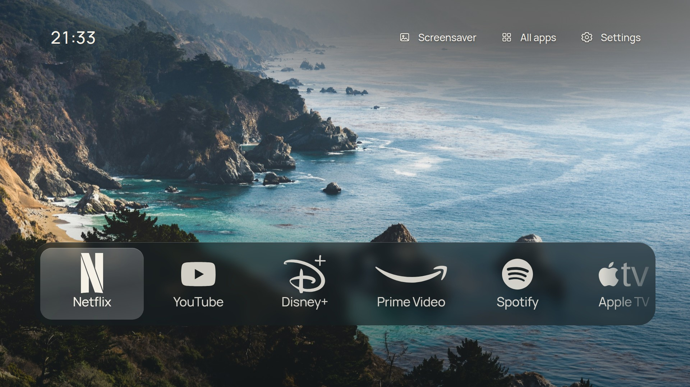
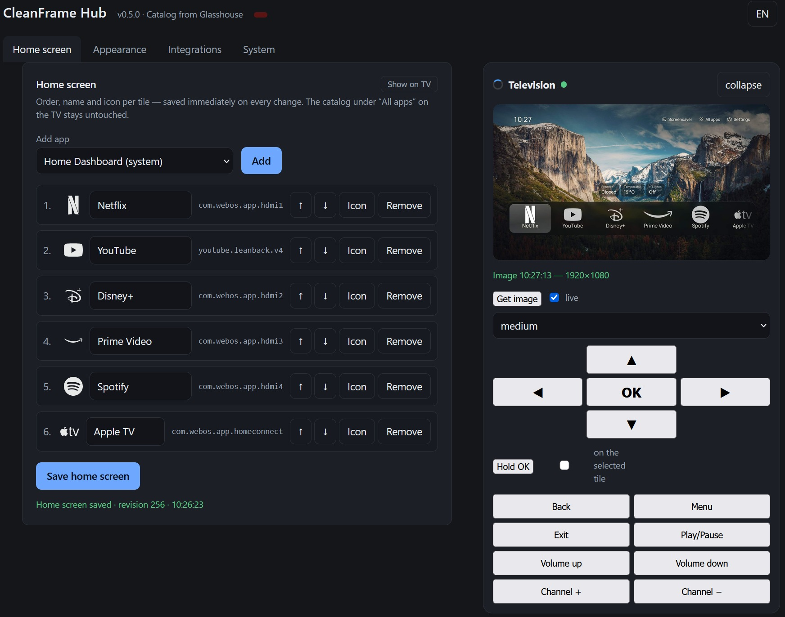

# CleanFrame für webOS

Inoffizielle Portierung von [CleanFrame](https://github.com/nthnclrk/CleanFrame) auf LG-Fernseher
mit webOS 6 oder neuer. Nicht mit dem Original verbunden, nicht vom ursprünglichen Autor betreut.

CleanFrame wurde für Samsung The Frame (Tizen) geschrieben: ein Foto, eine große Uhr und die eigenen
Apps. Gemeint war eine Startseite ohne den Ballast, den ein Hersteller mitliefert. Diese Portierung
übernimmt den Originalcode samt Oberfläche, Fokus-Logik, Einstellungen, Wandbildern und Materialien
und ersetzt nur die Geräteanbindung. `app/device.js` spricht den [Glasshouse](https://github.com/rorygallagher2024/glasshouse)-Server
auf dem Fernseher an statt der Tizen-API.



*Die Startseite: ein Foto, die Uhr, die Apps, die wirklich benutzt werden. Gerendert in 1920×1080,
ohne den Rahmen des Fernsehers.*



*Der Hub im Browser: jede Einstellung der App, gespeichert beim Ändern, dazu ein Live-Bild des
Fernsehers und eine Fernbedienung für die Fälle, in denen der Weg zum Sofa zu weit ist.*

[Im Homebrew Channel eintragen](https://github.com/TheLord83/CleanFrame-webos/releases/latest/download/repo.json):
eine Adresse, dann installieren und aktualisieren über den Channel. Oder das
[IPK aus dem Release](https://github.com/TheLord83/CleanFrame-webos/releases/latest) nehmen und in
Glasshouse geben. Die Einstellungsseite daneben ist optional.

## Zwei Teile

| Teil | Was es ist | Wo es läuft |
| --- | --- | --- |
| **Launcher** | Die Startseite als webOS-App (`com.blackpearl.cleanframe`), als IPK verpackt | Auf dem Fernseher |
| **CleanFrame Hub** | Konfigurations-Server mit Web-Oberfläche: Einstellungen ändern, Live-Bild holen, Tasten der Fernbedienung senden | Ebenfalls auf dem Fernseher, im LAN erreichbar |

Der Hub ist die maßgebliche Quelle der Konfiguration. Der Launcher liest sie beim Start und danach
alle zwei Sekunden neu, deshalb ist eine Änderung im Browser in Sekunden auf dem Bildschirm, ohne
Neustart und ohne Neuinstallation.

## Warum Root?

Die Installation ist zweiteilig, weil die beiden Teile unterschiedlich viel brauchen.

Der Launcher ist eine normale webOS-App. Er braucht einmal Root, weil das Installieren eines Pakets
auf einem unveränderten Fernseher über den App-Installer läuft und der nur über eine Root-Shell
erreichbar ist. Danach läuft die App ohne Root. Der mitgelieferte Hub läuft ebenfalls ohne
dauerhafte Rechte: er liegt im App-Verzeichnis und wird über den Dienst des Homebrew Channels
gestartet, der ohnehin als root läuft. Nur wer ihn dauerhaft haben will, legt ihn nach
`/var/lib/cleanframe` und gibt ihm einen Autostart-Eintrag.

Root ist damit eine Voraussetzung, keine Funktion dieses Projekts. Wie man dahin kommt, steht beim
[Homebrew Channel](https://github.com/webosbrew/webos-homebrew-channel): deren Anleitung deckt die
einzelnen Generationen ab und bleibt bei Firmware-Updates dran. Der Weg, der auf dem Testgerät hier
benutzt wurde, SlopBro plus Firmware-Gate, steht in [docs/ROOTING.md](docs/ROOTING.md) und ist
ausdrücklich ohne Support.

## Umfang

- Listenansicht und Leiste unten, Hintergrund Foto, Hell oder Dunkel, 15 Wandbilder mit Rotation
- Typografie, Fokus- und Materialstile, Uhr in 24 h oder 12 h, Oberfläche auf Deutsch und Englisch
- Senioren-Modus: größere Beschriftungen (mindestens 125 %) für den, der wirklich schaut
- Eigener App-Katalog: installierte webOS-Apps, HDMI-Eingänge und System-Apps, die Glasshouse nicht
  führt
- Kacheln umbenennen, Icons wählen, umsortieren, entfernen, mit Kontextmenü über die Fernbedienung
- Web-Oberfläche ohne PIN: Token optional, Anfragen vom lokalen Rechner sind immer erlaubt
- Home-Assistant-Werte als Kacheln, MQTT und Update-Sperre über Glasshouse
- Wetter neben der Uhr: ein dünnes Symbol und die Temperatur, Position und Größe nach Wunsch, geholt
  vom Hub bei Open-Meteo, damit der Fernseher selbst offline bleibt
- Bildschirmschoner, Einrichtungsassistent, Sicherung und Wiederherstellung der Konfiguration

Wo die Firmware-Nummer am Fernseher steht, mit beiden Wegen:
[docs/FIRMWARE.de.md](docs/FIRMWARE.de.md).

### Welche Fernseher

| | Geräte | Was zu erwarten ist |
| --- | --- | --- |
| **Getestet** | LG 43NANO779PA (NanoCell 2021), webOS 6.5.0-2401, Chromium 79, Glasshouse 0.118.0 | Alles, was hier steht |
| **Sehr wahrscheinlich** | andere webOS-6-Geräte (2021) | gleiche Browser-Engine, nicht ausprobiert |
| **Ungetestet** | webOS 7, 9, 10, 11 („webOS 23" bis „webOS 26"), OLED C und G | Keine Ahnung. Dafür sind Tester da |
| **Nicht unterstützt** | Fernseher ohne Root, ohne Homebrew Channel oder ohne Glasshouse | Der Launcher ist eine App, der Hub braucht eine Root-Shell |

Ein eigenes Bild kommt in der Einstellungsseite unter Darstellung, Hintergrund: Datei auswählen,
sie wird auf 1920x1080 zugeschnitten und neben der Konfiguration in `/var/lib/cleanframe/walls`
abgelegt. Der Fernseher holt sie über den Hub, sie funktioniert also solange der Hub erreichbar
ist; die mitgelieferten Wandbilder gehen auch ohne.

## Voraussetzungen

- ein LG-Fernseher mit webOS, gerootet. In der Praxis heißt das
  [Homebrew Channel](https://github.com/webosbrew/webos-homebrew-channel); wie man rootet, ist
  dessen Anleitung und nicht diese README
- [Glasshouse](https://github.com/rorygallagher2024/glasshouse) installiert und einmal geöffnet,
  Dashboard auf Port 8080. Es nimmt das IPK an, und der Launcher liest seine App-Liste dort
- ein Rechner im selben Netz. Für den Launcher reicht eine Shell mit `curl`. Für den Hub zusätzlich
  `ssh`, `scp`, `python3` (Linux, macOS) oder PowerShell mit OpenSSH-Client (Windows)

## Installieren

Zwei Wege, die funktionieren, und die Scripts, die experimentell sind und nicht der Einstieg.

| Weg | Wie | Braucht | Updates |
| --- | --- | --- | --- |
| **Homebrew Channel** | eine Repository-Adresse eintragen, aus dem Channel installieren | gerooteter Fernseher mit Channel | kommen von selbst |
| Von Hand | Glasshouse → Apps → *install from a file* | das IPK | neues IPK wieder installieren |
| Scripts | `tools/install-launcher.sh`, `tools/install-hub.sh` | `curl`, `python3`, SSH | **experimentell** |

Der Launcher ist ein IPK, und seit 0.5.3 steckt der Hub mit drin. Er startet mit der App und endet
mit ihr, dafür braucht es keine Shell. Ihn dauerhaft laufen zu lassen ist der optionale zweite Schritt.

### 1. Homebrew Channel

So werden die anderen Launcher in der Szene verteilt, und ab jetzt ist es auch hier der normale
Weg. Der Channel liest eine Repository-Datei, und jede spätere Version kommt von dort, ohne dass du
etwas tun musst.

1. Homebrew Channel auf dem Fernseher, *Settings*, *Add repository*
2. diese Adresse eintragen:

```text
https://github.com/TheLord83/CleanFrame-webos/releases/latest/download/repo.json
```

3. CleanFrame steht dann in der App-Liste des Channels, dort installieren
4. CleanFrame einmal aus der App-Liste starten, damit es sich einrichtet

Die Adresse zeigt auf das jeweils neueste Release, sie muss also nie geändert werden. Wer
festnageln will, was er installiert, nimmt dieselbe Datei aus dem Repo:
[`repo/apps.json`](repo/apps.json)
(`raw.githubusercontent.com/TheLord83/CleanFrame-webos/main/repo/apps.json`).
`tools/make-apps-json.py` schreibt beide aus dem gebauten IPK, mit Hash, Größe, Manifest und
Download-URL.

### 2. Von Hand, fünf Minuten

Sinnvoll, solange der Channel noch nicht installiert ist, oder wenn du genau sehen willst, welche
Datei auf den Fernseher geht.

1. das IPK aus dem [aktuellen Release](https://github.com/TheLord83/CleanFrame-webos/releases/latest)
   holen, oder selbst bauen: `python3 tools/build-ipk.py app dist/cleanframe_all.ipk --hub web`
2. Glasshouse → Apps → *install from a file* → IPK wählen → Versionsabfrage bestätigen
3. CleanFrame einmal aus der App-Liste starten

### Die Einstellungsseite im Browser

Der Hub ist der Teil mit der Weboberfläche: Home-Assistant-Werte, die Auswahl der Entitäten, MQTT,
die Fernbedienung, Sicherung und Wiederherstellung. Er ist ein node-Prozess auf dem Fernseher, und
das IPK bringt ihn mit. Nach der Installation aus dem Channel öffnest du also

```text
http://<tv-ip>:8484/
```

und die Seite ist da. `app/hubboot.js` startet den Server beim Start von CleanFrame über den Dienst
des Homebrew Channels, wartet, bis er antwortet, und beendet ihn, wenn die App zumacht. Auf dem
Fernseher passiert dabei nichts Dauerhaftes: keine Shell, kein Root, kein Autostart-Eintrag.

Der Preis ist Zeit. Ein mitgelieferter Hub lebt so lange wie die Web-Seite des Launchers. Kommt eine
andere App nach vorn, antwortet er weiter, weil webOS die Seite im Hintergrund behält. Nach einem
Neustart läuft nichts, bis CleanFrame einmal startet, und genau dafür ist er gedacht. Auf dem
Testgerät gemessen: die Seite antwortete vier Sekunden nach dem Start und blieb erreichbar, während
eine andere App im Vordergrund war.

Wer die Seite auch dann will, wenn der Fernseher etwas anderes zeigt, installiert den Hub dauerhaft.
Das braucht eine Root-Shell und legt den Autostart an:

```sh
./tools/install-hub.sh --tv <tv-ip>
```

oder von Hand:

```sh
scp -r web root@<tv-ip>:/var/lib/cleanframe
ssh root@<tv-ip> 'chmod +x /var/lib/cleanframe/cleanframectl && /var/lib/cleanframe/cleanframectl restart'
```

Beide Wege nutzen dieselbe Konfigurationsdatei, und ein dauerhaft installierter Hub hat Vorrang: der
mitgelieferte sieht Port 8484 belegt und bleibt still, es läuft also nie ein zweiter Server.
Einzelheiten samt Autostart-Hook: [docs/INSTALL.md](docs/INSTALL.md).

### 3. Die Scripts (experimentell)

Es sind drei: `install-launcher.sh` (IPK über Glasshouse, kein SSH), `install-hub.sh` (der Hub per
SSH) und `install.sh` (beides, und es rootet nie). Sie sind geschrieben, sie laufen, und sie sind
auf genau einem Fernseher benutzt worden, dem 43NANO779PA aus dieser README. Kein zweites Modell,
keine zweite webOS-Version, kein Windows-Rechner, kein macOS.

Nimm einen der Wege oben, außer du willst sie debuggen. Sie suchen den Fernseher im Netz, bauen das
IPK, laden es hoch und prüfen das Ergebnis. Bequem, aber jeder dieser Schritte ist eine Annahme über
dein Netz.

```sh
./tools/install-launcher.sh --tv <tv-ip>     # die App, kein SSH
./tools/install-hub.sh --tv <tv-ip>          # die Einstellungsseite, SSH als root
./tools/install.sh --tv <tv-ip>              # beides
./tools/install.sh --info                    # Modell, webOS, node, Root-Zustand
```

Sie halten an, statt zu raten: kein Glasshouse heißt kein Installieren, eine Sitzung ohne root heißt
kein Hub. `--dry-run` zeigt den Plan, `--lang de` antwortet deutsch, `--help` den Rest.

## Entfernen

CleanFrame im Channel oder in Glasshouse deinstallieren, und die App ist weg. Wenn der gebündelte Hub
gelaufen ist, bleibt eines liegen: `/var/lib/cleanframe/config.json` mit dem Home-Assistant-Token und
dem MQTT-Passwort. Dasselbe Verzeichnis gehört auch zu einer dauerhaften Installation, deshalb löscht
es nichts automatisch. Wer es weg haben will:

```sh
ssh root@<tv-ip> 'rm -rf /var/lib/cleanframe'
```

Eine dauerhafte Installation räumt `./tools/uninstall-web.sh <tv-ip>` sauber ab: Dienst stoppen,
Autostart-Haken weg, Verzeichnis löschen.

## Bauen und prüfen

```sh
python3 tools/build-ipk.py app ipk/cleanframe_all.ipk --hub web   # IPK, Hub inklusive
tools/check-all.sh                                      # alle Prüfungen, ohne Fernseher
tools/make-port-patch.sh                                # docs/PORT-CHANGES.patch neu erzeugen
```

`tools/check-all.sh` startet selbst einen Konfigurations-Server und ein kopfloses Chrome und fährt
Syntax, node-8-Verträglichkeit, Icons, API, Tastendrücke, Live-Übernahme und die Linkprüfung in
einem Lauf. Einzelheiten in [docs/TESTS.md](docs/TESTS.md). Dasselbe Skript läuft in der CI bei
jedem Push.

## Dokumentation

- [docs/INSTALL.md](docs/INSTALL.md): vom Seriengerät zur laufenden Startseite (englisch)
- [docs/ROOTING.md](docs/ROOTING.md): wozu Root gut ist und woher es kommt (englisch)
- [docs/TROUBLESHOOTING.md](docs/TROUBLESHOOTING.md): Symptom, Ursache, Kommando (englisch)
- [docs/WEB.md](docs/WEB.md): Hub-API, Konfigurationsschema, Betrieb des Dienstes
- [docs/TESTS.md](docs/TESTS.md): was geprüft wird und wie
- [docs/ICONS.md](docs/ICONS.md): Icon-Bibliothek und ihre Quellen
- [docs/asset-sources.md](docs/asset-sources.md): jedes Foto mit Fotograf und Lizenz
- [docs/PORT-CHANGES.patch](docs/PORT-CHANGES.patch): der vollständige Unterschied zum Original

## Was anders ist als beim Original

`app/device.js` ist neu. `app/main.js` hat ein überschaubares Delta (webOS-App-IDs,
LG-Beschriftungen, Fernbedienung, Prüfschnittstelle), `app/style.css` enthält
Chromium-79-Verträglichkeit, `app/i18n.js` und `app/appinfo.json` sind neu, `app/config.xml`
(Tizen-Verpackung) entfällt. Alles unter `app/assets/` ist byte-identisch zum Original.

## Garantie und Risiko

Root und fremde IPKs können Garantie- und DRM-Funktionen beeinflussen; das Installieren erfolgt auf
eigenes Risiko. Die App-ID ist `com.blackpearl.cleanframe`, und sie geht über den Sideload-Weg von
Glasshouse auf den Fernseher wie jede andere Homebrew-App. Was getestet ist und was nicht, steht
unter [Welche Fernseher](#welche-fernseher).

## Probleme und Fragen

Für alles, was kein Sicherheitsproblem ist, ein
[Issue](https://github.com/TheLord83/CleanFrame-webos/issues) aufmachen. Eine Meldung ist zehnmal so
viel wert mit Modell, webOS-Version und einem Foto vom Bildschirm. Sicherheitsprobleme gehören in
den Tab **Security** des Repos, *Report a vulnerability*, nicht in ein öffentliches Issue.

## Lizenz und Grenzen

- Eigener Code (webOS-Anbindung, Verpackung, Bau-Skripte): MIT, siehe [LICENSE](LICENSE). Dort
  stehen beide Copyright-Zeilen, die des Originals und die der Portierung
- Original CleanFrame: MIT, Nathan Clark
- Oberfläche und Assets stammen aus CleanFrame: MIT für den Code, getrennte Bedingungen für
  Schriften (OFL), Icons (CC0/MIT) und Fotos (Unsplash License). Alles in
  [THIRD_PARTY_NOTICES.md](THIRD_PARTY_NOTICES.md), die Foto-Quellen in
  [docs/asset-sources.md](docs/asset-sources.md)
- Marken wie Netflix, YouTube oder Disney+ gehören ihren Inhabern. Dieses Projekt behauptet keine
  Zugehörigkeit oder Unterstützung

English: [README.md](README.md)
