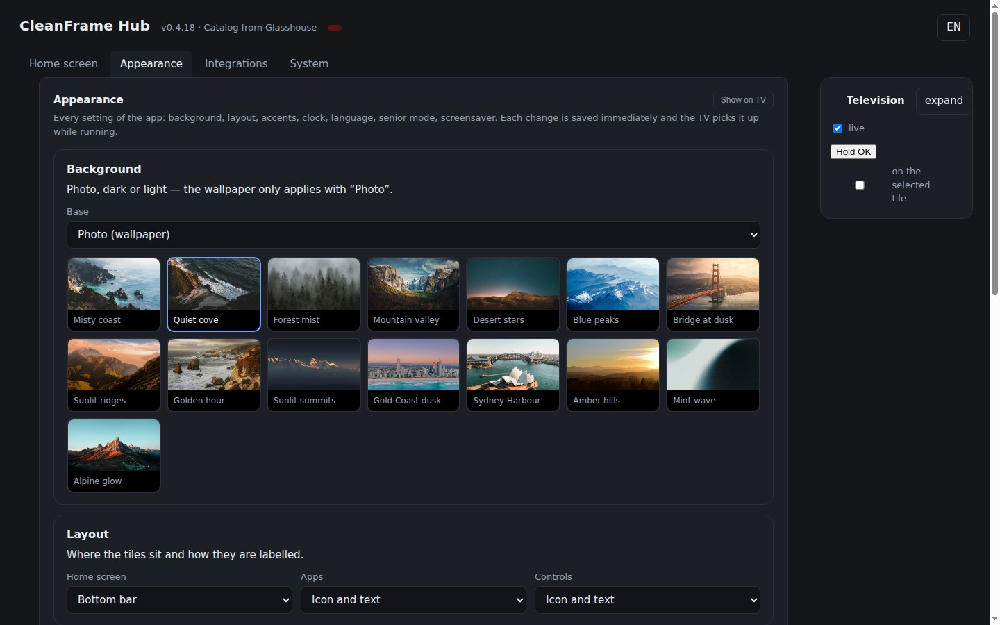

# CleanFrame for webOS

**Unofficial port of [CleanFrame](https://github.com/nthnclrk/CleanFrame) to LG TVs running
webOS 6 or newer.** Not affiliated with the original project and not maintained by its author.

CleanFrame was written for the Samsung The Frame (Tizen): one photo, a large clock, your own
apps — instead of a cluttered manufacturer start screen. This port keeps the original code —
layout, focus logic, settings, wallpapers, materials — and replaces only the device layer:
`app/device.js` talks to [Glasshouse](https://github.com/rorygallagher2024/glasshouse) on the
TV instead of the Tizen API.


*The start screen: one photo, the clock, the apps you actually use. Rendered at 1920×1080,
no chrome from the TV around it.*



*The hub in the browser: every setting of the app, saved as you change it — plus a live
picture of the TV and a remote control for the cases where walking to the TV is too far.*

## Two parts

| Part | What it is | Where it runs |
| --- | --- | --- |
| **Launcher** | The start screen as a webOS app (`com.blackpearl.cleanframe`), packaged as an IPK | On the TV |
| **CleanFrame Hub** | Configuration server and web interface: edits settings, shows a live picture, sends remote key presses | Also on the TV, reachable from the LAN |

The hub owns the configuration. The launcher reads it at start and re-reads it every two
seconds, so a change made in the browser is visible on screen within seconds — no restart, no
reinstall.

## Why root?

The **launcher** is a normal webOS app and runs without root. The **hub** does not: it lives
in `/var/lib/cleanframe`, starts itself at boot and installs the launcher IPK, all of which
needs a root shell. Root is also what lets the TV stay offline-update-free and what makes the
live picture possible.

Rooting uses a public exploit — no Developer Mode, no LG account, no service menu:

```sh
./tools/install.sh --root
```

That finds the TV on the network, serves the exploit through
[SlopBro](https://github.com/throwaway96/slopbro), waits for the root shell, installs your SSH
key, closes Telnet and blocks the LG update hosts. **One thing stays manual: accept the pairing
prompt on the TV once.** Everything else is scripted, and the run is idempotent — on an
already-rooted TV it says so and moves on.

Which exploit works depends on model and firmware: check your TV on
<https://cani.rootmy.tv> first. If the firmware is newer than the exploit, no root — and a
downgrade is out of scope here. Details and the manual path: [docs/INSTALL.md](docs/INSTALL.md).

## Features

- List layout and bottom dock, photo / light / dark background, 15 wallpapers with rotation
- Typography, focus and material styles, clock in 24 h or 12 h, German and English interface
- Senior mode: larger labels (at least 125 %) for the person actually watching
- Own app catalogue: installed webOS apps, HDMI inputs, and system apps Glasshouse does not list
- Rename tiles, choose icons, reorder or remove them — context menu on the remote included
- Web interface without a PIN: token optional, requests from the local machine always allowed
- Home Assistant values as tiles; MQTT and update blocking through Glasshouse
- Screensaver, setup wizard, backup and restore of the configuration

## Requirements

- LG TV with webOS 6 or newer, **rooted** (Homebrew Channel installed)
- Glasshouse on the TV, reachable at `127.0.0.1:8080`
- IPK installation through `luna://com.webos.appInstallService/dev/install` or the Glasshouse
  dashboard (Apps → Sideload)

## Install

### Linux and macOS

```sh
./tools/install.sh                  # find the TV, install launcher and hub
./tools/install.sh --root           # same, but root the TV first
./tools/install.sh --info           # only report model, webOS version, node
```

Real output of such a run (TV: 43NANO779PA, launcher 0.4.17 at the time):

```text
$ ./tools/install.sh 192.168.1.50
==> Looking for the TV
    TV answers (SSH open)
==> Checking prerequisites
    node 8.12.0
    Glasshouse answers (192.168.1.50:8080)
==> Plan
    install the launcher IPK: /path/to/dist/cleanframe_all.ipk
    set up the hub: /var/lib/cleanframe, autostart, port 8484
Proceed? [Y/n] y
==> Installing the launcher
   package cleanframe_all.ipk for com.blackpearl.cleanframe
   uploading 15802724 bytes
   confirming com.blackpearl.cleanframe 0.4.17
   installed: com.blackpearl.cleanframe 0.4.17 (16750825 bytes)
==> Setting up the hub
==> Verifying
    hub answers: {"ok":true,"name":"cleanframe-web","version":"0.4.17",...}
    launcher is in the app list: com.blackpearl.cleanframe 0.4.17
    launcher is on screen (live picture available)
==> Result
    interface: http://192.168.1.50:8484/
```

### Windows (PowerShell)

```powershell
.\tools\install.ps1                # find the TV, install launcher and hub
.\tools\install.ps1 -Root          # same, but root the TV first
.\tools\install.ps1 -Info          # only report model, webOS version, node
```

Windows needs the OpenSSH client (a Windows feature) and, for `-Root` and the network
search, Python 3 on `PATH` — the upstream tools are Python. Output looks like this
(`-DryRun`, i.e. detect and plan only):

```text
PS> .\tools\install.ps1 -DryRun
==> Looking for a TV on the network
    found: 192.168.1.50
==> Checking prerequisites
    node 8.12.0
    Glasshouse answers (192.168.1.50:8080)
==> Plan
    install the launcher IPK: C:\...\dist\cleanframe_all.ipk
    set up the hub: /var/lib/cleanframe, autostart, port 8484

(dry run: nothing was changed)
```

### What it does in both cases

It starts by asking the TV whether it already has a root shell. If not, it offers to root it
(`Root it now? [Y/n]`) — the launcher runs without root, the hub does not, so with `n` (or
`--no-root` / `-NoRoot`) it installs the launcher only and says that the hub was skipped.

The address is **optional**: the script searches the local network (SSDP plus a port
scan, verified by a real SSAP handshake) and takes the only TV it finds. Pass an address
only when there are several: `./tools/install.sh 192.168.1.50` (`-Tv 192.168.1.50` on
Windows).

One run puts both parts on the TV: it builds the IPK, uploads it through Glasshouse's
installer, sets up the hub with autostart, then proves the result — the hub answers on
port 8484, the app is in the catalogue, and the hub can take a picture of the launcher
(which means it is really on screen). `--dry-run` (`-DryRun`) only detects, checks and
prints the plan; `--info` (`-Info`) prints model, webOS version and node version.

Rooting is scripted too (`--root` / `-Root`); what stays is one pairing prompt on the TV.
Step by step in [docs/INSTALL.md](docs/INSTALL.md).

## Build and test

```sh
python3 tools/build-ipk.py app ipk/cleanframe_all.ipk   # IPK
tools/check-all.sh                                      # all checks, no TV required
tools/make-port-patch.sh                                # refresh docs/PORT-CHANGES.patch
```

`tools/check-all.sh` starts its own configuration server and a headless Chrome, then runs
syntax, node 8 compatibility, icon, API, remote-key and live-apply checks in one go. Details in
[docs/TESTS.md](docs/TESTS.md). The same script runs in CI on every push.

## Documentation

- [docs/INSTALL.md](docs/INSTALL.md) — from a stock TV to a running start screen
- [docs/TROUBLESHOOTING.md](docs/TROUBLESHOOTING.md) — symptom, cause, command
- [docs/WEB.md](docs/WEB.md) — hub: API endpoints, configuration schema, operating the service
- [docs/TESTS.md](docs/TESTS.md) — what is tested and how
- [docs/ICONS.md](docs/ICONS.md) — icon library and its sources
- [docs/PORT-CHANGES.patch](docs/PORT-CHANGES.patch) — full difference to upstream

## Differences to upstream

`app/device.js` is new; `app/main.js` has a contained delta (webOS app IDs, LG labels, remote
handling, test hooks); `app/style.css` has Chromium 79 compatibility fixes; `app/i18n.js` and
`app/appinfo.json` are new; `app/config.xml` (Tizen packaging) is gone. Everything under
`app/assets/` is byte-identical to the original.

## Tested on

- LG 43NANO779PA (NanoCell 2021), webOS 6.5.0-2401 (`kisscurl-koli`), Chromium 79, rooted
- Glasshouse 0.118.0 as the device bridge
- Installed through the Glasshouse sideload path, app ID `com.blackpearl.cleanframe`

No promise for other models. Rooting and sideloading third-party packages can affect warranty
and DRM features; install at your own risk.

## Licence and credits

- Port code (webOS bridge, packaging, build scripts): MIT — see [LICENSE](LICENSE); both
  copyright lines are in there (original and port)
- Original CleanFrame: MIT, Nathan Clark
- Interface and assets come from CleanFrame: MIT for code, separate terms for fonts (OFL),
  icons (CC0/MIT) and photos (Unsplash Licence) — see
  [THIRD_PARTY_NOTICES.md](THIRD_PARTY_NOTICES.md), photo sources in
  [docs/wallpaper-SOURCES.json](docs/wallpaper-SOURCES.json)
- Brands such as Netflix, YouTube or Disney+ belong to their owners. This project claims no
  affiliation and no endorsement.

Deutsche Fassung: [README.de.md](README.de.md)
