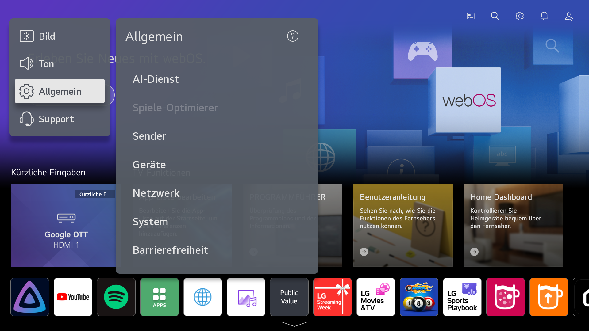
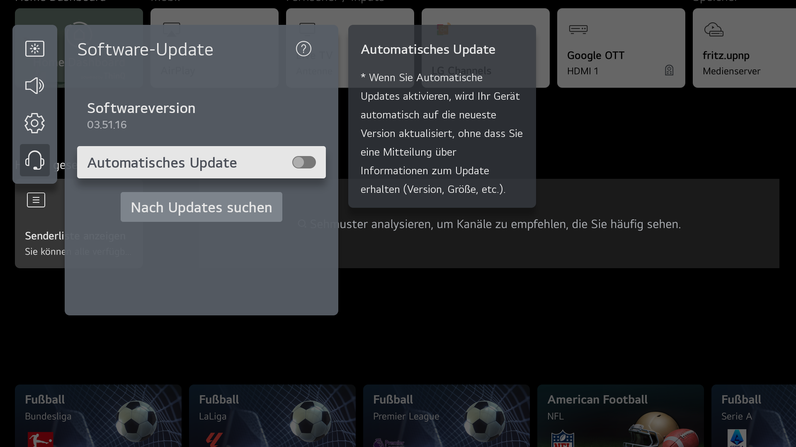

# Wo steht meine Firmware, und wo mein Modell?

Der Installer fragt nach der **Software-Version** — das ist die Nummer, die LG als Firmware
bezeichnet —, weil sie entscheidet, ob der Fernseher noch rootbar ist. Das Modell findet er
meistens selbst. Diese Seite zeigt, wo beides am Gerät steht, und wie man es ohne Menü
herausbekommt.

## Der Menüweg

```
Einstellungen
  → Alle Einstellungen
    → Allgemein
      → Geräte
        → TV-Management
          → TV-Informationen
```

Neuere Versionen nennen den letzten Punkt **Info zu diesem TV**. Gleicher Bildschirm, gleiche
Zahlen.



Am schnellsten steht die Zahl unter **Support → Software-Update** — derselbe Wert, ein Klick
weniger:



## Was der Bildschirm zeigt

| Was dasteht | Sieht aus wie | Wofür |
| --- | --- | --- |
| **Software-Version** | `03.51.16` — drei Zahlen mit Punkten | die Rootbarkeits-Prüfung (die fragt der Installer ab) |
| Modell | `43NANO779PA` | die Plattform (hier `kisscurl`, W21A) und die Exploit-Grenze |
| Seriennummer | `000MANJ00000` | Support, und um zwei Fernseher auseinanderzuhalten |

Drei Verwechslungen, die ständig passieren:

* Die **webOS TV-Version** (`6.5.0-2401`) ist **nicht** die Firmware. Die Exploit-Tabellen hängen
  an der Software-Version; die webOS-Version sagt nur, welche Generation das Gerät ist.
* Die Software-Version **ändert sich mit jedem LG-Update** — ein Screenshot von letztem Jahr
  beweist nichts.
* Ähnliche Modellnummern können auf anderen Plattformen sitzen: `43NANO779PA` ist `kisscurl`
  (W21A); eine `43NANO766QA` ist es nicht.

## Screenshots vom Fernseher, für einen Bericht oder ein Forum

Mit root gibt es einen Aufnahme-Dienst — und ja, er nimmt auch LGs eigene Bildschirme auf
(Startseite, Einstellungen, Info-Panel), nicht nur den Browser:

```sh
./tools/screenshot.py                                  # 1920x1080 PNG ins aktuelle Verzeichnis
./tools/screenshot.py -o info.png                      # eigener Name
./tools/screenshot.py --format JPG --width 1280 --height 720
```

Dasselbe als Knopf gibt es im Hub: **System → Bildschirmfoto** (`POST /api/tv/screenshot`,
`GET /api/tv/screenshot.png`). Darunter steckt genau ein Luna-Aufruf auf dem Fernseher:

```sh
luna-send -n 1 -f luna://com.webos.service.capture/executeOneShot \
  '{"path":"/tmp/shot.png","method":"DISPLAY","format":"PNG","width":1920,"height":1080}'
```

Zwei Dinge, die eine Stunde kosten, wenn man sie nicht kennt:

* Auf webOS 6.5 existiert der Dienst `com.webos.service.tv.capture` (der Name aus den meisten
  Anleitungen) **nicht** — Antwort: `Service does not exist`. Nimm `com.webos.service.capture`.
* `luna-send` gibt **nichts** aus, wenn es über ssh im Vordergrund läuft; derselbe Aufruf im
  Hintergrund ist in unter einer Sekunde fertig. Antwort in eine Datei auf dem Fernseher
  schreiben und die dann lesen.
* Der Framebuffer scheidet aus: `/dev/fb0` existiert, aber `dd` sagt `No such device` — das Gerät
  hält `surface-manager`.

## Ohne Menü

Ist der Fernseher gerootet, muss nichts abgetippt werden:

```sh
./tools/install.sh 192.168.1.50 --info
```

```text
==> Was der Fernseher ohne root ueber sich verraet (SSAP getSystemInfo)
    model:     43NANO779PA
    aus der Root-Shell gelesen (os_info.json)
    webOS:     webOS TV Lite 6.5.0
    firmware:  03.51.16
    platform:  kisscurl-koli
```

Zwei weitere Stellen zeigen dieselben Zahlen:

* der Hub, Tab **System → Fernseher** (`http://<tv>:8484/`), oder `GET /api/tv/info` als JSON,
* der Fernseher selbst: `/var/run/nyx/os_info.json` (`webos_manufacturing_version`) und
  `/var/run/nyx/device_info.json` (`product_id`) — beides einfache Dateien, kein Dienst nötig.

Bei einem **nicht gerooteten** Gerät kommen über das Netz nur Modell und Seriennummer heraus
(`ssap://system/getSystemInfo`). Die Firmware gibt LG nur in einer gepaarten Sitzung oder über
eine Root-Shell heraus. Genau deshalb fragt der Installer.

## Was der Installer damit macht

```sh
./tools/install.sh --tv 192.168.1.50 --firmware 03.51.16   # für Skripte
./tools/install.sh --tv 192.168.1.50                        # er fragt
```

* Firmware unter der Grenze des passenden Exploits → er macht weiter,
* Firmware darüber → er stoppt und zeigt den vorbefüllten Link
  `https://cani.rootmy.tv/?q=<Modell>+<Firmware>`, statt den Fernseher anzufassen,
* beide Zahlen unbekannt → er warnt, zeigt den Link und überlässt die Entscheidung dir.

Überstimmen mit `--force-root` (PowerShell: `-ForceRoot`), wenn du weißt, dass die Tabelle
hinterherhinkt. Einzelheiten: [INSTALL.md](INSTALL.md).

---

English: [FIRMWARE.md](FIRMWARE.md)
