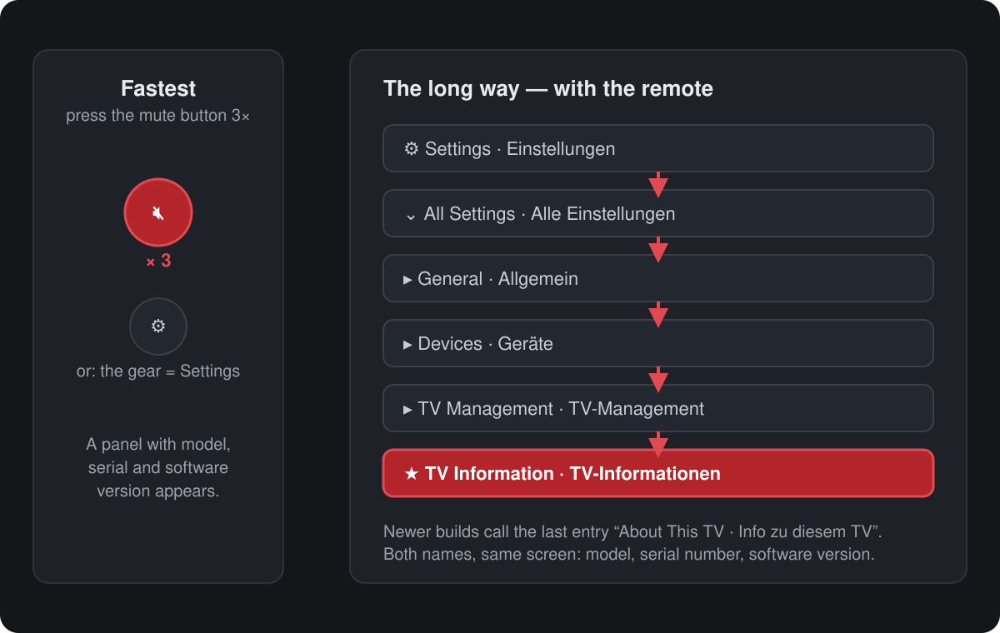
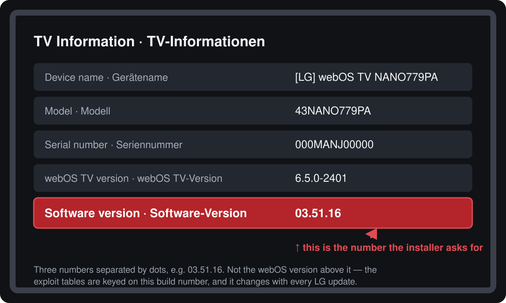

# Where is my firmware, and where is my model?

The installer asks for the **firmware version** (the "software version") because that number
decides whether the TV can still be rooted. The model it usually finds by itself. This page
shows both — with the two ways to get them off the TV, and with what to do when you have a
root shell and do not want to walk a menu at all.



> The pictures are drawings, not photos of a TV: your model draws the same screens with its own
> fonts and a slightly different order. What matters is the labels and the path.

## Way 1 — three presses of the mute button (fastest)

1. Turn the TV on.
2. Press **MUTE** on the remote three times in a row.
3. A panel appears with **device name, model, serial number and the software version**.

This works without opening any menu, and it works on TVs where the settings have been
rearranged by an update.

## Way 2 — the settings menu

```
Settings · Einstellungen
  → All Settings · Alle Einstellungen
    → General · Allgemein
      → Devices · Geräte
        → TV Management · TV-Management
          → TV Information · TV-Informationen
```

Newer builds name the last entry **About This TV · Info zu diesem TV**. Same screen either way.



## What to write down

| On screen | Looks like | Needed for |
| --- | --- | --- |
| **Software version · Software-Version** | `03.51.16` — three numbers, dots between them | the rootability check (this is the one the installer asks for) |
| Model · Modell | `43NANO779PA` | the platform (here: `kisscurl`, W21A) and the exploit ceiling |
| Serial number · Seriennummer | `000MANJ00000` | support, and telling two TVs apart |

Three things people mix up:

* The **webOS TV version** (`6.5.0-2401`) is *not* the firmware. The exploit tables are keyed on
  the software version; the webOS version only says which generation the TV is.
* The software version **changes with every LG update**, so a screenshot from last year proves
  nothing.
* Model numbers that look similar can sit on different platforms — `43NANO779PA` is `kisscurl`
  (W21A), a `43NANO766QA` is not.

## Without walking any menu

If the TV is already rooted, nothing has to be typed by hand:

```sh
./tools/install.sh 192.168.1.50 --info
```

```text
==> What the TV tells about itself without root (SSAP getSystemInfo)
    model:     43NANO779PA
    read from the root shell (os_info.json)
    webOS:     webOS TV Lite 6.5.0
    firmware:  03.51.16
    platform:  kisscurl-koli
```

Two more places show the same numbers:

* the hub, tab **System → Fernseher** (`http://<tv>:8484/`), or `GET /api/tv/info` as JSON,
* the TV itself: `/var/run/nyx/os_info.json` (`webos_manufacturing_version`) and
  `/var/run/nyx/device_info.json` (`product_id`) — both plain files, no service needed.

On an **unrooted** TV only model and serial number come out over the network
(`ssap://system/getSystemInfo`); the firmware is one of the things LG hands out only inside a
paired session or over a root shell. That is exactly why the installer asks.

## What the installer does with the answer

```sh
./tools/install.sh --tv 192.168.1.50 --firmware 03.51.16   # scripted
./tools/install.sh --tv 192.168.1.50                        # it asks
```

* firmware below the ceiling of the matching exploit → it continues,
* firmware above it → it stops and prints the pre-filled
  `https://cani.rootmy.tv/?q=<model>+<firmware>` link instead of touching the TV,
* both numbers unknown → it warns, prints the link, and leaves the decision to you.

Override with `--force-root` (PowerShell: `-ForceRoot`) if you know the table is behind. Details:
[INSTALL.md](INSTALL.md).
