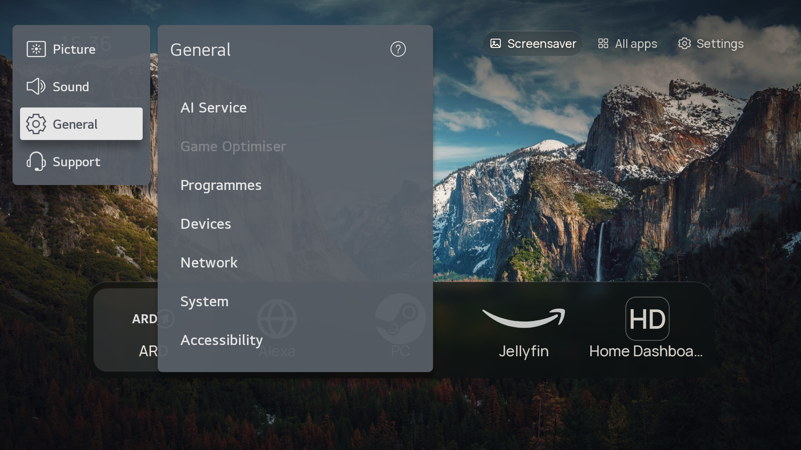
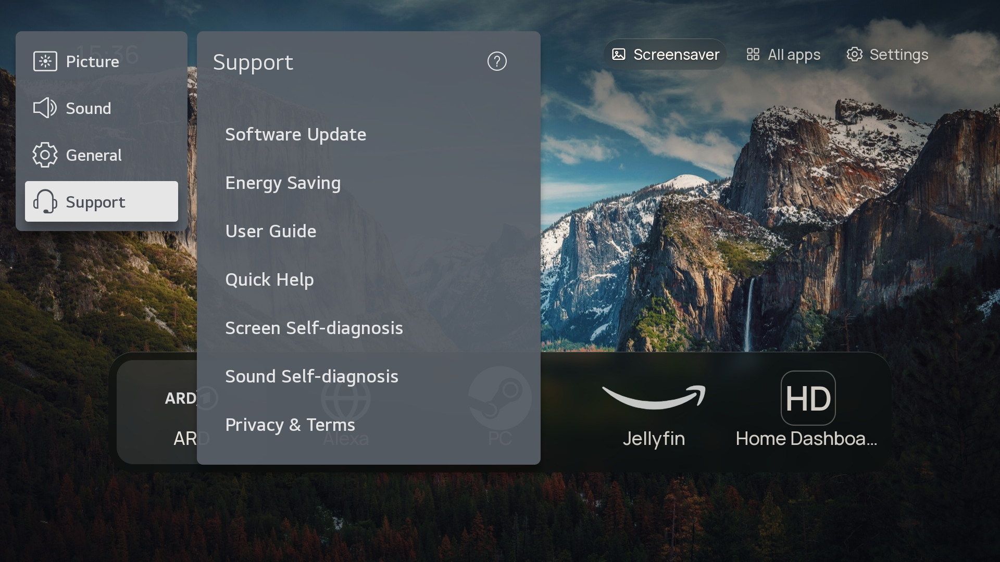
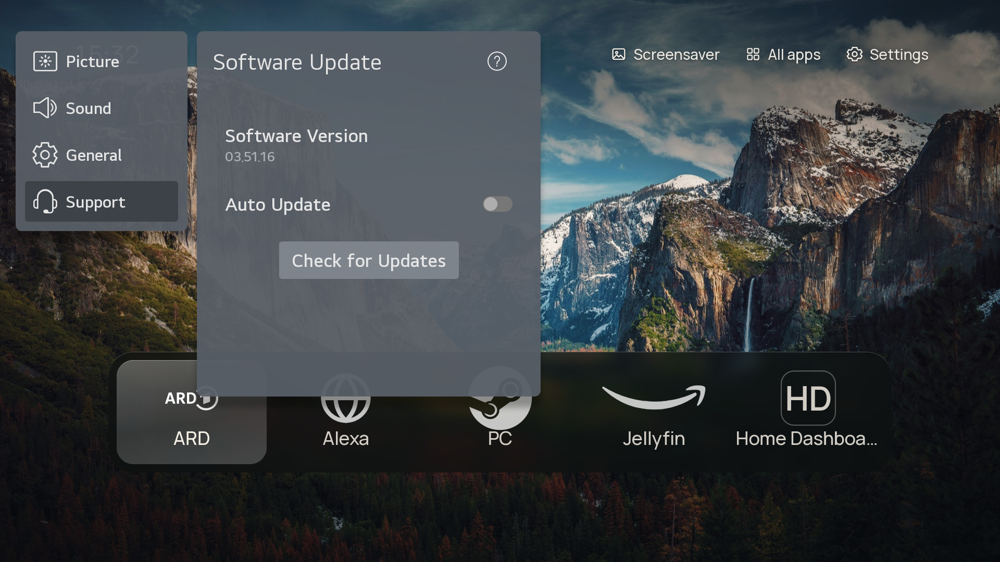

# Where is my firmware, and where is my model?

The installer asks for the **software version**, which is the number LG calls the firmware, because
it decides whether the TV can still be rooted. The model it usually finds by itself. This page shows
where both are on the TV, and how to get them without walking a menu.

## The menu path

```
Settings
  → All Settings
    → General
      → Devices
        → TV Management
          → TV Information
```

Newer builds name the last entry **About This TV**. Same screen, same numbers.



The quickest number is under **Support → Software Update**: same value, one click less:





## What the screen shows

| On screen | Looks like | Needed for |
| --- | --- | --- |
| **Software version** | `03.51.16`: three numbers, dots between them | the rootability check (this is the one the installer asks for) |
| Model | `43NANO779PA` | the platform (here `kisscurl`, W21A) and the exploit ceiling |
| Serial number | `000MANJ00000` | support, and telling two TVs apart |

Three things people mix up:

* The **webOS TV version** (`6.5.0-2401`) is *not* the firmware. The exploit tables are keyed on the
  software version; the webOS version only says which generation the TV is.
* The software version **changes with every LG update**, so a screenshot from last year proves
  nothing.
* Similar model numbers can sit on different platforms: `43NANO779PA` is `kisscurl` (W21A), and a
  `43NANO766QA` is not.

## Screenshots of the TV, for a report or a forum post

With root there is a capture service, and it also captures LG's own screens (home screen,
settings, the info panel), not only the browser:

```sh
./tools/screenshot.py                                  # 1920x1080 PNG into the current directory
./tools/screenshot.py -o info.png                      # given name
./tools/screenshot.py --format JPG --width 1280 --height 720
```

The same thing as a button lives in the hub: **System → Screenshot** (`POST /api/tv/screenshot`,
`GET /api/tv/screenshot.png`). Under the hood it is one Luna call on the TV:

```sh
luna-send -n 1 -f luna://com.webos.service.capture/executeOneShot \
  '{"path":"/tmp/shot.png","method":"DISPLAY","format":"PNG","width":1920,"height":1080}'
```

Two things that cost an hour when you do not know them:

* On webOS 6.5 the service `com.webos.service.tv.capture` (the name in most guides) **does not
  exist**, and the answer is `Service does not exist`. Use `com.webos.service.capture`.
* `luna-send` prints **nothing** when it runs in the foreground over ssh; the same call
  backgrounded finishes in under a second. Write the reply to a file on the TV and read it.
* The framebuffer is not an option: `/dev/fb0` exists, but `dd` answers `No such device` because
  `surface-manager` holds the device.

## Without walking any menu

If the TV is rooted, nothing has to be typed by hand:

```sh
./tools/install.sh 192.168.1.50 --info
```

```text
==> What the TV tells about itself without root (SSAP getSystemInfo)
    model:     43NANO779PA
    read from the root shell (os_info.json)
    webOS:     webOS TV Lite 6.5.0
    firmware:  03.51.16
    platform:  kisscurl-koli
```

Two more places show the same numbers:

* the hub, tab **System → TV** (`http://<tv>:8484/`), or `GET /api/tv/info` as JSON,
* the TV itself: `/var/run/nyx/os_info.json` (`webos_manufacturing_version`) and
  `/var/run/nyx/device_info.json` (`product_id`), both plain files with no service in between.

On an **unrooted** TV only model and serial number come out over the network
(`ssap://system/getSystemInfo`). The firmware is one of the things LG hands out only inside a paired
session or over a root shell. That is exactly why the installer asks.

## What the installer does with the answer

```sh
./tools/install.sh --tv 192.168.1.50 --firmware 03.51.16   # scripted
./tools/install.sh --tv 192.168.1.50                        # it asks
```

* firmware below the ceiling of the matching exploit → it continues,
* firmware above it → it stops and prints the pre-filled
  `https://cani.rootmy.tv/?q=<model>+<firmware>` link instead of touching the TV,
* both numbers unknown → it warns, prints the link and leaves the decision to you.

Override with `--force-root` (PowerShell: `-ForceRoot`) if you know the table is behind.
Details: [INSTALL.md](INSTALL.md).

---

Deutsch: [FIRMWARE.de.md](FIRMWARE.de.md)
