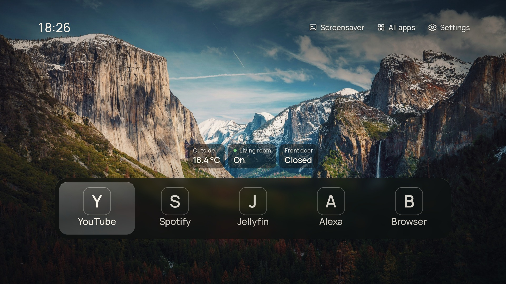
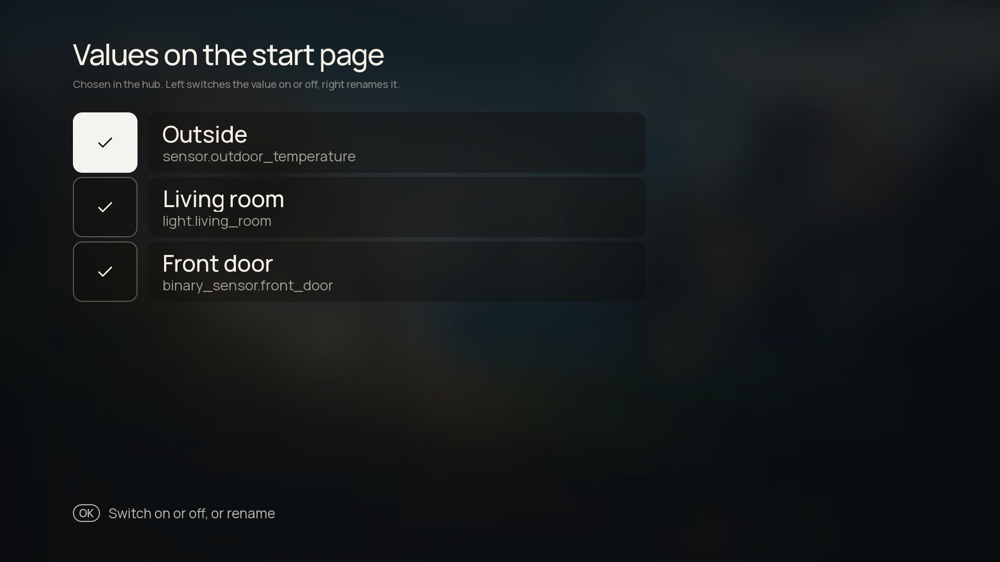
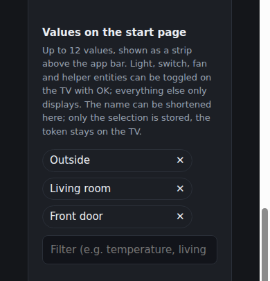

# CleanFrame on webOS: a quiet start page with Home Assistant values on it

*Post for r/webos. Title above, body below. Upload these three screenshots with the post, in this
order: `img/beta-start-page.jpg`, `img/beta-values-page.jpg`, `img/beta-hub-mobile.png`.*

---

I ported CleanFrame, an open-source launcher for Samsung's The Frame, to LG televisions running
webOS, and I am looking for people who want to try it on hardware that is not mine.

The idea is simple. The start page shows a photograph, a clock and your apps. No recommendations,
no rows of sponsored content, no LG account in the middle of it. If you run Home Assistant, you can
put a few values on that page: the temperature outside, whether the window is open, the lamp in the
corner. The lamps can be switched from the page with the remote, and everything else is configured
in a browser on your phone.



## What you need

Root. The launcher is a normal web app package, so it installs through the webOS Homebrew Channel,
and it needs a rooted television to get there. Rooting is the Homebrew Channel's own guide, I am not
going to repeat it here.

The Home Assistant part is optional. Without it you get the photograph, the clock and your apps.

## Installing

Add this address as a repository in the Homebrew Channel:

```
https://github.com/TheLord83/CleanFrame-webos/releases/latest/download/repo.json
```

After that CleanFrame appears in the channel's list and installs like any other app, with updates
when I publish a new version. The package is 7,8 MB. The rest of the ways, by script or by hand with
Dev Manager, are in the README.



## What it does

Wallpapers with an adaptive background that takes its colour from the picture, a clock, a dock or a
grid for your apps, and an optional row of Home Assistant values that you pick and name yourself,
because `sensor.outdoor_temperature` is not a label you want to read from the sofa.

The settings live in a small server that comes with the app. Start CleanFrame, open
`http://<tv-ip>:8484/` in a browser, and you get a live preview of the television next to the
controls, a remote, the Home Assistant connection, backup and restore, and a senior mode with larger
text.



## What it does not do

No accounts, no telemetry, no analytics, no cloud. It talks to your Home Assistant and to nothing
else. It does not replace your apps, it starts them: the tiles launch what is already installed.

## Honest about the state

I have exactly one television, a 43NANO779PA on webOS 6.5, and that is the only device this has run
on. Other webOS 6 sets are likely to work. webOS 7 and newer are untested, and I would rather hear
that it breaks on your C2 than guess. The code is written for the browser in webOS 6, Chromium 79,
so anything newer is a gamble in the good direction.

The settings page runs on the television, which means it is only reachable while the TV is awake.
There is a documented way to install it permanently on the set, but the default is: TV on, settings
available.

If you uninstall the app, one file stays behind: `/var/lib/cleanframe/config.json`, which holds the
Home Assistant token. The README says how to remove it.

## Links

Code, releases and documentation: https://github.com/TheLord83/CleanFrame-webos

CleanFrame for Tizen, by Nathan Clark, is the original and the reason this exists:
https://github.com/nthnclrk/CleanFrame. The webOS port is unofficial and not maintained by him.

The Homebrew Channel: https://github.com/webosbrew/webos-homebrew-channel

Glasshouse, which I use to launch apps and to trim the TV down before any of this is useful:
https://github.com/webosbrew/glasshouse

Feedback is welcome, especially "it does not start on my model" with the model and the webOS
version in it. That is the part I cannot test myself.
